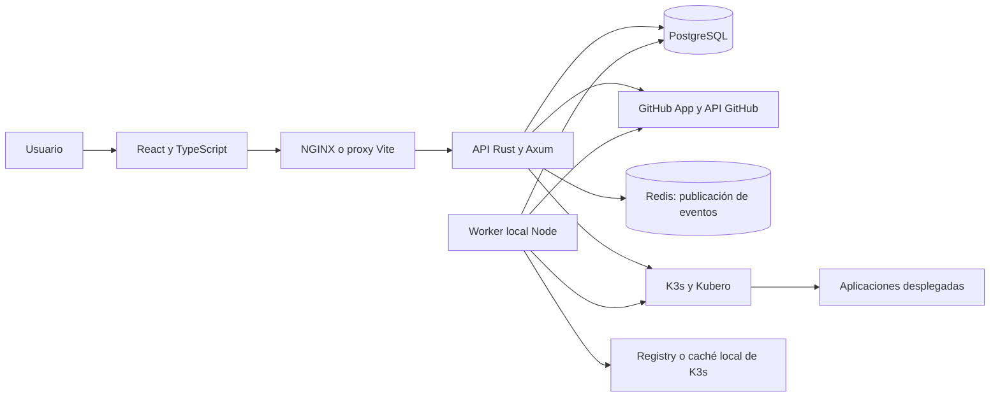

# Arquitectura de Atlas

Este documento describe los componentes y conexiones de la implementación actual. El [flujo del proyecto](project-flow.md) describe su recorrido funcional objetivo; los [issues](https://github.com/djromerom/kubero-wrapper/issues) registran el trabajo pendiente. Un paso diseñado no se considera implementado por estar documentado.

Atlas engloba el dashboard, la API, los workers, Kubero y los clústeres donde se alojan los proyectos. K3s proporciona Kubernetes dentro de esta plataforma; no se instala un segundo Kubernetes aparte.

## Componentes y conexiones

## Interfaz

`frontend/` utiliza React, TypeScript, Vite y Tailwind CSS 4. El router distingue acceso, proyectos, administración y documentación. La interfaz se organiza en `login`, `sidebar`, `content` y componentes compartidos.

`src/api.ts` centraliza solicitudes HTTP bajo `/api` y agrega el JWT de Atlas. En desarrollo las recibe Vite; en el frontend compilado NGINX las dirige al backend. La sesión local se conserva en `localStorage`.

El detalle de proyecto consulta periódicamente el backend. El frontend no establece actualmente conexiones SSE ni WebSocket. Clúster y notificaciones contienen placeholders.

## API y persistencia

`backend/` ejecuta Axum sobre Tokio. Al iniciar carga configuración, conecta PostgreSQL, aplica migraciones, prepara el bus de eventos e intenta configurar Kubernetes. Puede continuar sin clúster si `KUBERNETES_REQUIRED=false`.

Los handlers resuelven autenticación, proyectos, revisiones, configuración, despliegue, logs y webhooks. El middleware verifica JWT y acceso administrativo. El acceso local usa Argon2 y JWT; la identidad institucional definida en los issues todavía no está implementada.

SQLx accede a usuarios, vinculaciones GitHub, proyectos, configuración y builds. El esquema conserva un estado principal, SHA de origen, reporte de adaptación e imagen aprobada. Aún no implementa todo el modelo de estados independientes ni el historial completo de admisión, CI, retención y recuperación. Los cambios futuros se introducen mediante nuevas migraciones, conservando las ya aplicadas.

## GitHub

La GitHub App vincula una cuenta al usuario de Atlas mediante OAuth. El backend intercambia el código, consulta identidad e instalaciones y guarda la vinculación. Después consulta repositorios y ramas autorizados y resuelve el último SHA; el usuario no selecciona un commit.

La integración implementada y el diseño de transferencia/aprovisionamiento de CI todavía deben reconciliar sus responsabilidades y permisos.

## Eventos y actualización

El backend publica eventos en Redis y en un canal local de Tokio. No hay un consumidor conectado que convierta esos eventos en actualizaciones de la interfaz.

Existe `/api/ws`, pero el frontend no lo utiliza y no está enlazado con la publicación de eventos. SSE es el mecanismo objetivo de los issues y requiere implementación. Redis no actúa como una cola duradera de trabajos: el worker actual obtiene sus tareas desde PostgreSQL.

## K3s, Kubero y worker

El gestor Rust usa el API de Kubernetes y los CRD de Kubero para consultar y administrar recursos. En el laboratorio de imágenes externas/locales, scripts Node realizan adaptación y despliegue fuera del proceso API.

El monitor reclama desde PostgreSQL proyectos en adaptación o aprobados. Para adaptar descarga el SHA, inspecciona compatibilidad y solicita la construcción a Kubero; conserva reporte e imagen verificada. Para desplegar utiliza esa imagen, prepara los servicios PostgreSQL/Redis configurados, ejecuta migraciones y workers y comprueba la aplicación antes de actualizar su estado.

`infra/kubero-operator/` adapta el chart de construcción del operador. El laboratorio utiliza K3s mediante k3d en Docker Desktop, Traefik para ingress y `local-path` para volúmenes. Los overlays Compose permiten conectar la API al laboratorio o a un clúster externo con Registry. Kind conserva compatibilidad para recuperar el entorno anterior durante la migración.

Esta implementación todavía no completa el ciclo objetivo de transferencia a OpenLab, CI por proveedor y despliegue mediante artefacto aprobado. Sus pasos permanecen en `project-flow.md`; sus discrepancias con los requisitos se reconciliarán por separado.

## Ejecución y validación

Compose separa PostgreSQL, Redis, API y frontend. La API escucha en el puerto 3000 y el frontend local en 5173. Kubernetes ejecuta las aplicaciones desplegadas; no es necesario para probar autenticación y HTTP.

GitHub Actions comprueba Atlas con tres workflows: backend, frontend y scripts. La suite Rust inicia el backend real contra PostgreSQL/Redis de pruebas; también puede ejecutar el cliente TypeScript a través de Vite. Las pruebas unitarias del cliente simulan las respuestas del servidor.

El CI de Atlas valida este repositorio. El CI de proyectos alojados es otro ámbito del diseño y no queda implementado por la existencia de estos workflows.
